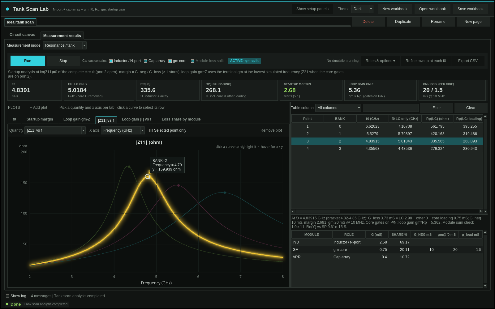
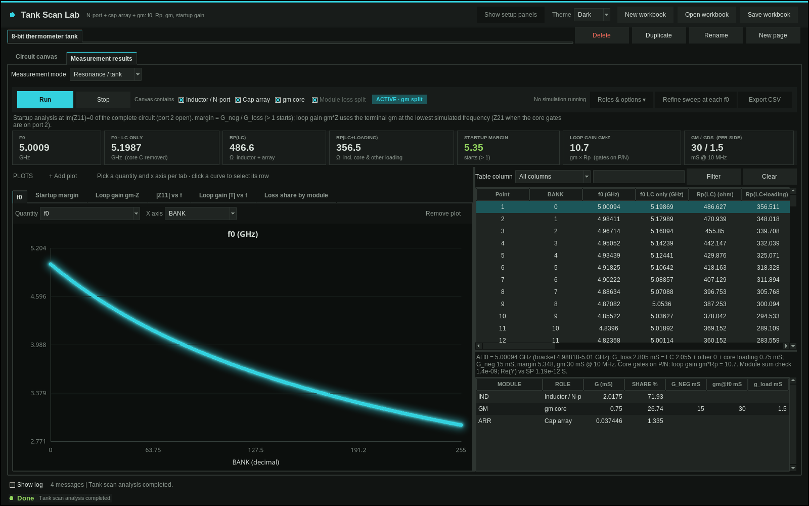
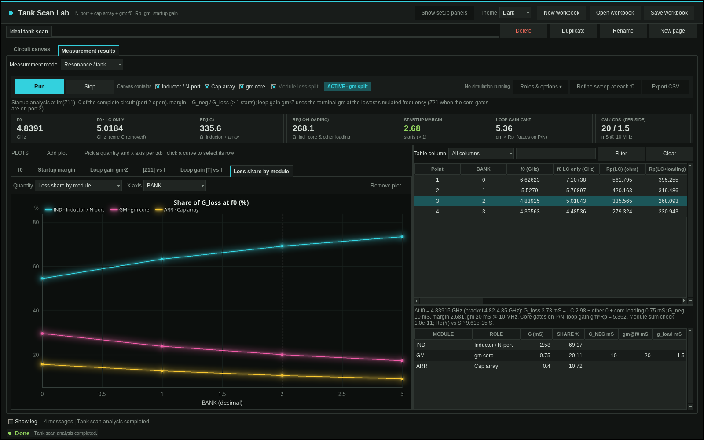
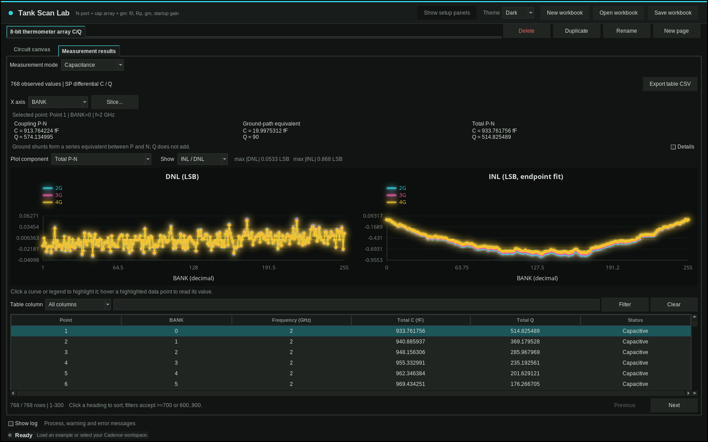
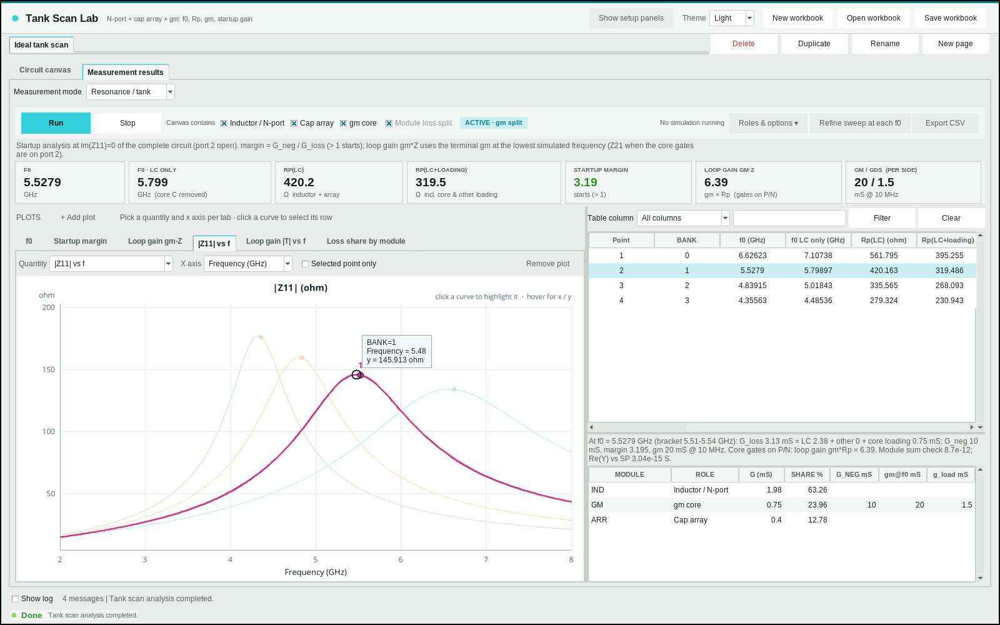

[简体中文](README.zh-CN.md)

# Tank Scan Lab

A desktop workbench for LC-tank startup analysis: place an N-port inductor, a switched capacitor array and a cross-coupled (or transformer-coupled) gm core, and read f0, Rp, gm/gds, the startup margin and the loop gain for every code from one small-signal run. It also measures capacitor-array C/Q, C step and INL/DNL, decomposes floating-port parasitics and bundles Z11 Studio. The project was formerly named Cap Array Lab.



| | |
|---|---|
|  |  |
|  |  |

## What it does

**Capacitance mode (C/Q)**

- Draw circuits, connect named nets or wires, and scan decimal control registers across independent workbook pages.
- Per code: differential C and Q, split into the coupling (P-N) component, the ground-path equivalent and the single-ended P / N shunts; floating P/N total admittance.
- **Show → C step / INL / DNL:** capacitance step per code and endpoint-fit DNL / INL in LSB, one curve per observation frequency, with the worst |DNL| and |INL|. Derived from saved results; nothing is simulated.

**Resonance / tank mode** (the former Resonance and Tank scan modes, merged; old pages open in it)

- Tick what the canvas contains (inductor / N-port, cap array, gm core) to pick the **passive** or **active** backend. Per code: f0, LC-only f0, Rp(LC), Rp(LC+loading), terminal gm/gds, G_neg, startup margin, loop gain, Q, C_eff/L_eff.
- **Module loss split:** per-module share of G_loss at f0 from native module currents; untick it for a fast resonance-only run (f0, Z11, Rp = Re Z).
- **Optional port 2** (pin roles P2 / N2): four-port SP, Z21, and transformer-coupled cores with their gates on port 2, whose loop gain is **gm·Z21**. Transformer tanks with two resonances use the one with the larger margin.
- **Plot manager:** any number of plot tabs, each with a quantity and an x axis: per-code values, |Z11| / phase / Re / Im and |Z21| versus frequency, loop gain |T|, loss share by module. Click a curve to select its table row (and the reverse); hover for x / y. KPI tiles, plots left, results and loss tables right, all dividers draggable.
- **Refine sweep at each f0:** adds a 0.1 % step band around every code's f0 (overlapping windows merged) for bracket-level accuracy.
- **Dark / Light theme** for the whole window, canvas and plots; anti-aliased plots with a neon glow in Dark when Pillow is installed, plain Tk canvas otherwise.
- Export the results table to CSV; save self-contained workbooks with every page and its data.

See [docs/TANK_SCAN.md](docs/TANK_SCAN.md) for definitions and validation.

**Also included:** Touchstone (N-port) import and RF component placement in your own Cadence installation, and Z11 Studio for standalone RLC drawing, nodal analysis, linked sweeps and optimization.

## Requirements

The core workbench and synthetic examples use Python 3.6+ and Tk 8.5+ with no third-party packages. A graphical display is required. Linux is the supported launch platform. [Pillow](https://python-pillow.org/) is optional: with it the plots are anti-aliased (and glow in the Dark theme); without it they are drawn with plain Tk canvas items. `CAPLAB_ANTIALIAS=0` forces the plain canvas (useful on RealVNC-based X servers such as Cadence's cdsXvnc, which is detected automatically), `CAPLAB_ANTIALIAS=1` forces Pillow.

Z11 Studio additionally requires NumPy 1.17+ and Matplotlib 3.3+. CMA-ES optimization optionally requires `cma`; differential evolution and NSGA use NumPy. On Python 3.6, compatible versions include NumPy 1.19.5 and Matplotlib 3.3.4. Core Tk tests were run with Python 3.6; Z11 GUI validation used an existing modern Python environment. The Z11 numerical solver was also tested with Python 3.6 and NumPy 1.19.5.

Native library browsing, symbol import, SP measurements, module-current loss analysis and schematic creation require your own Cadence Virtuoso/Maestro/Spectre installation, library mappings, device models and licenses. None are included. EMX is not invoked by this product; provide your own Touchstone files for extracted networks.

## Install / Quick start

From the repository root, open the offline example first:

```bash
python3 app.py --project examples/ideal_array.json
```

For the resonance / tank mode, open the synthetic tank example (analytic L, switched C and cross-coupled gm; four codes):

```bash
python3 app.py --tank --project examples/ideal_tank.json
```

`bash tank-scan-lab.sh` starts the workbench directly in the **Resonance / tank** mode; **Load example** there opens the tank example. Saved data are re-analyzed when roles or the ticked contents change; running a new scan needs your native environment.

Large-code examples (synthetic 8-bit thermometer array, codes 0–255):

```bash
python3 app.py --tank --project examples/thermo8_cq.json        # C/Q, C step, INL/DNL (Capacitance mode)
python3 -m caplab.thermo_example --tank                          # writes examples/thermo8_tank.json (~45 MB, not committed)
python3 app.py --tank --project examples/thermo8_tank.json      # f0, Rp, margin, gain for 256 codes
```

Alternatively, run `bash launch.sh` and click **Load example**. Select **Ideal capacitor array** for C/Q, or **Parallel LC resonance** (it opens in **Resonance / tank**: f0, Rp = Re Z and |Z11| / phase per code). **Run SP / Measure C + Q** replays the analytic fixture when an example page is active; its status explicitly identifies synthetic replay. **Stop this page** cancels it. Replay uses a fixed eight-code model and fixed saved frequency grid; editing the circuit does not change that model. Start a new workbook for native work.

The example contains no PDK or simulated device data. Its formulas, units, reproducibility and synthetic Touchstone file are described in [examples/README.md](examples/README.md).

For Z11 Studio, install optional packages in an environment you manage:

```bash
python3 -m pip install -r requirements-z11.txt
bash caplab/z11/z11_launch
```

The **Z11 Studio** button opens the same bundled program. With no workspace it runs offline; with a configured native workspace it uses a source-bound schematic broker. `Z11_PYTHON` may select a separate interpreter. The core interface is English; Z11 retains its original Chinese interface.

## Using with Cadence

Configure your own environment; no site paths or license values are bundled:

| Setting | Meaning |
| --- | --- |
| `CAPLAB_PYTHON` | GUI interpreter; defaults to `python3` on PATH |
| `CAPLAB_WORKSPACE` | Default workspace containing your `cds.lib`; empty by default |
| `CAPLAB_LIBRARY` | Default target library name; defaults to `CAP_DEMO` |
| `CAPLAB_NATIVE_VIRTUOSO` | Native executable; defaults to `virtuoso` on PATH |
| `CAPLAB_CADENCE_ENV` | Optional trusted shell script sourced by the standalone native child |
| `CAPLAB_NATIVE_CDS_LIB` | Optional absolute path to a private library mapping file |
| `Z11_PYTHON` | Optional Z11 interpreter; otherwise uses the current GUI interpreter |
| `CAPLAB_Z11_PATH` | Optional external Z11 installation override; the bundled copy is the default |

Provide your Cadence and license environment yourself. GUI launch isolates Python/Tk library overrides; Maestro launch captures its native environment separately. See [docs/CADENCE.md](docs/CADENCE.md) for the menu entry and configuration details. Native workflows were preserved; the tank analysis was cross-checked on native runs during development (numbers in [docs/VALIDATION.md](docs/VALIDATION.md)), but no native tools were run for the repository checks.

## CLI for agents

```bash
python3 app.py --help
python3 app.py --project examples/ideal_array.json
python3 app.py --tank --project examples/ideal_tank.json
python3 -m caplab.demo
python3 -m caplab.tank_example
python3 -m caplab.thermo_example [--tank] [OUT_DIR]
python3 -m unittest discover -s tests -p 'test_*.py'
```

`caplab.demo` regenerates the two synthetic C/Q example files; `caplab.tank_example` regenerates `examples/ideal_tank.json`; `caplab.thermo_example` regenerates `examples/thermo8_cq.json` and, with `--tank`, writes the 8-bit tank workbook. `--context` is the internal Maestro launch-context entry, not a general netlist runner. Tests requiring Tk skip without `DISPLAY`; use a display assigned to you for full UI tests. The full suite includes NumPy-based Z11 tests. There is no headless native simulation CLI.

## Limitations

- Resonance / tank values are small-signal values at the DC operating point, i.e. a **startup** analysis. Steady-state oscillation frequency, swing, gain compression and phase noise need large-signal (HB / transient) simulation. Values at f0 interpolate between the two bracketing samples; use **Refine sweep at each f0** for accuracy.
- Port 2 results assume the gates (or output) are on P2/N2 and port 2 is open for the one-port quantities. Loop gain gm·Z21 uses the low-frequency gm; a wrong gate polarity shows as a negative gain.
- C step / INL / DNL use an endpoint fit over the plotted code range of the selected component; they are derived from the saved C values, not from a separate simulation.
- Saved-spectrum interpolation is linear in complex admittance and never extrapolates. Coarse grids can miss narrow/high-Q resonance crossings.
- Floating P/N decomposition is a terminal equivalent, not a physical capacitor inventory. Q values do not add.
- Module loss shares require complete, balanced native current data. The synthetic C/Q example deliberately reports these as unavailable; the synthetic tank example includes module currents.
- Workbook files may contain your own local paths, library identities and results. Review them before sharing. Runtime state is written into ignored `.work/` and `runs/` directories; Z11 has its own saved state.
- The tools do not perform DRC/LVS signoff. Touchstone import accepts supported full-matrix ASCII S-parameter formats; unsupported keywords or changed files are rejected.

## RF-FIELDWORK

Product page: https://rf-fieldwork.pages.dev/tank/?lang=en

Other open-source tools:

- [Flux Studio](https://github.com/chloeyntu-byte/flux-studio): parametric RF passives, EMX sweeps, multi-objective search and SNPFit
- [Layout 3D Viewer](https://github.com/chloeyntu-byte/layout-3d-viewer): read IC layouts in 3D, locate pins and trace connections
- [VCO ISF Explorer](https://github.com/chloeyntu-byte/vco-isf-explorer): ISF, flicker-noise up-conversion and phase-noise contributions
- [Crescendo](https://github.com/chloeyntu-byte/crescendo): automatic device-size optimization inside Cadence Maestro
- [VCO Design Studio](https://github.com/chloeyntu-byte/vco-design-studio): five literature LC VCO topology families, packaged schematics and native export

## License

MIT. See [LICENSE](LICENSE).
