[English](README.md)

# Tank Scan Lab

LC 谐振腔起振分析桌面工作台：在画布上放 N-port 电感、开关电容阵列和交叉耦合（或变压器耦合）gm 核心，一次小信号运行即可逐码读出 f0、Rp、gm/gds、起振裕量和环路增益。同时提供电容阵列 C/Q、C 步进与 INL/DNL 测量、浮地端口寄生分解，并内置 Z11 Studio。本项目原名 Cap Array Lab。

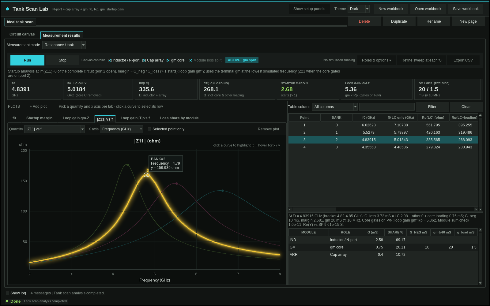

## 为什么需要 Tank Scan Lab

给带开关电容阵列的 LC VCO 调参时，通常每个码都要做一遍：搭带端口夹具的测试台，逐个器件抵消核心的跨导，跑 AC，再手工后处理。Rp 和起振增益只能近似得到，端口数据也看不出损耗落在哪个模块。Tank Scan Lab 一次原生运行，逐码完成这些工作。

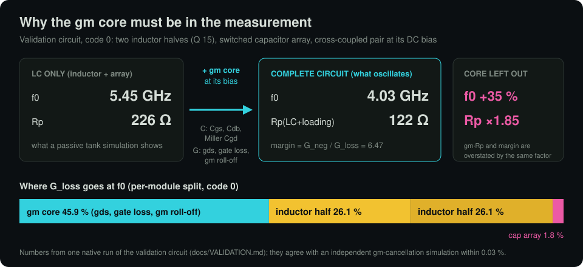

**频率和 Rp 都要把整个核心算进去，包括 gds。** 交叉耦合对在 DC 偏置下不只是“−gm”：它给储能腔加上电容（Cgs、Cdb、Miller Cgd）和电导（gds、栅极损耗、gm 的射频滚降）。验证电路里，只仿真电感加阵列得到 f0 = 5.45 GHz，完整电路的起振频率是 4.03 GHz。核心电导还让 Rp 几乎减半（226 → 122 Ω），按无源储能腔算出的 gm·Rp 和起振裕量会乐观 1.85 倍。Tank Scan Lab 在工作点上测量完整电路，在核心端口读取 gm 和 gds；端口 gm 已经包含串联电阻的退化（验证运行中比器件本征 gm 低约 8 %）。

**按模块看损耗，才知道该改哪里。** Rp 偏低只能说明有地方在损耗。工具在每个模块的每个端口都放了探针，计算各模块在 f0 处吸收的功率（各模块导纳之和与端口导纳的偏差约 1e-13）。验证电路里核心占 G_loss 的 46 %，两半电感各 26 %，阵列 1.8 %：改善阵列开关几乎没用，减轻核心负载或提高电感 Q 才有效。占比随码变化（大电容码的开关 Ron、关断态负载），所以逐码列出，也能对码作图。

**变压器耦合核心要用 gm·Z21。** 栅极接在变压器次级时，栅极摆幅不等于漏极摆幅。环路增益是 gm 乘以 gm 抵消后储能腔从漏到栅的转移阻抗 Z21，而不是 gm·Rp。把栅极网络设为管脚角色 P2 / N2，工具就给出 gm·Z21 和栅漏比，次级一侧的损耗仍计入 G_loss。

**电容阵列不只看一个电容值。** 任何带开关电容阵列的模块（DCO/VCO 电容阵列、可调滤波器、匹配网络、移相器）都需要逐码看：决定调谐的差分 C，决定共模行为和不对称的 P / N 对地单端分量，反映开关 Ron 的 Q，反映步进均匀性、漏码和非单调的 C 步进与 DNL，以及校准表需要修正的 INL。这些都由已保存的 SP 频谱得到，换观察频率不必重跑。

**精度与耗时。** 与独立的有源仿真（每个核心器件的端口 gm 用仅交流的 VCCS 抵消，浮置 1 A 驱动）相比，偏差小于 0.03 %：Rp 122.11 对 122.13 Ω，起振裕量 6.470 对 6.471，变压器耦合核心的 gm·Z21 18.407 对 18.407。分析在 DC 工作点做小信号线性化：给出起振频率和裕量，不给稳态频率和摆幅（这两项用 HB 或瞬态）。阵列很大时，线性分析比 HB 省得多。按估算，复杂电路每次 HB 需 30 s 时，256 个码 HB 约需 2 小时 8 分，Tank Scan Lab 约 15 分钟（不含搭建测试台）；换算依据是验证电路上实测的分析耗时比 1 : 8.7。

## 功能

**Capacitance 模式（C/Q）**

- 在画布搭电路，通过同名网络或连线连接，按十进制寄存器逐码扫描，工作簿各页独立。
- 逐码给出差分 C 与 Q，并拆分为 coupling（P-N）分量、ground-path 等效支路和 P / N 单端对地分量；同时给出浮地 P/N 总导纳。
- **Show → C step / INL / DNL：** 逐码电容步进，以及端点拟合的 DNL / INL（单位 LSB），每个观察频率一条曲线，并显示最大 |DNL|、|INL|。由已保存结果计算，不另行仿真。

**Resonance / tank 模式**（原 Resonance 与 Tank scan 两种模式合并，旧页面会自动打开到这里）

- 勾选画布包含的内容（电感 / N-port、电容阵列、gm 核心）选择**无源**或**有源**后端。逐码给出 f0、仅 LC 的 f0、Rp(LC)、Rp(LC+loading)、端口 gm/gds、G_neg、起振裕量、环路增益、Q、C_eff/L_eff。
- **Module loss split：** 由原生模块电流得到 f0 处各模块占 G_loss 的比例；没有 gm 核心时可取消勾选，只做快速谐振分析（f0、Z11、Rp = Re Z）。
- **可选端口 2**（引脚角色 P2 / N2）：四端口 SP、Z21，支持栅极接在端口 2 上的变压器耦合核心，其环路增益为 **gm·Z21**。有两个谐振的变压器谐振腔取裕量更大的那个。
- **绘图管理：** 可增删任意多个绘图标签页，每页选择物理量和 X 轴：逐码数值、|Z11| / 相位 / 实部 / 虚部和 |Z21| 随频率的曲线、环路增益 |T|、各模块损耗占比。点击曲线选中对应表格行（反之亦然），悬停读数。KPI 卡片、左侧绘图、右侧结果表和损耗表，分隔条均可拖动。
- **Refine sweep at each f0：** 在每个码的 f0 附近加入 0.1 % 步进的频点带（相互重叠的窗口自动合并），把 f0 区间收窄到采样精度。
- 整个窗口、画布和图表可切换 **Dark / Light 主题**；安装 Pillow 时图表抗锯齿，Dark 主题下曲线带霓虹辉光，否则使用普通 Tk 画布绘制。
- 结果表导出 CSV；工作簿保存所有页面及其数据。

定义与验证见 [docs/TANK_SCAN.md](docs/TANK_SCAN.md)。

**另外包含：** 在用户自己的 Cadence 环境中导入 Touchstone（N-port）并放置 RF 器件；Z11 Studio 用于独立绘制 RLC 网络、节点分析、联动扫描和优化。

## 图集

| | |
|---|---|
| 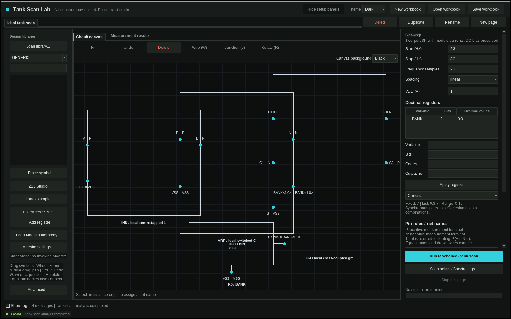 | 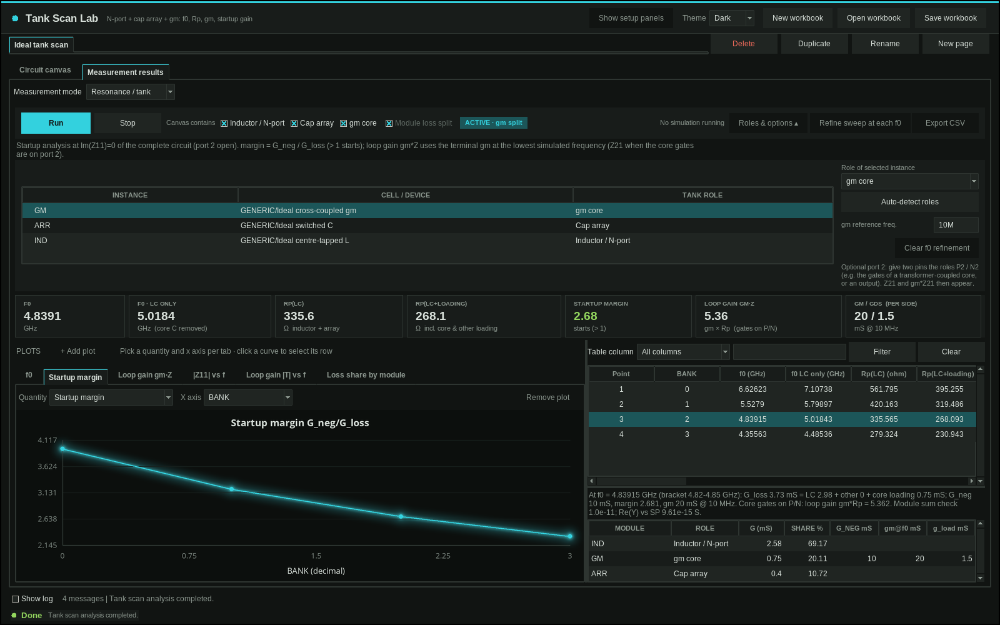 |
| 画布：N-port 或电感、寄存器驱动的阵列和 gm 核心，用命名网络连接。 | 勾选画布包含的模块（决定无源或有源分析），核对每个实例的角色。 |
| 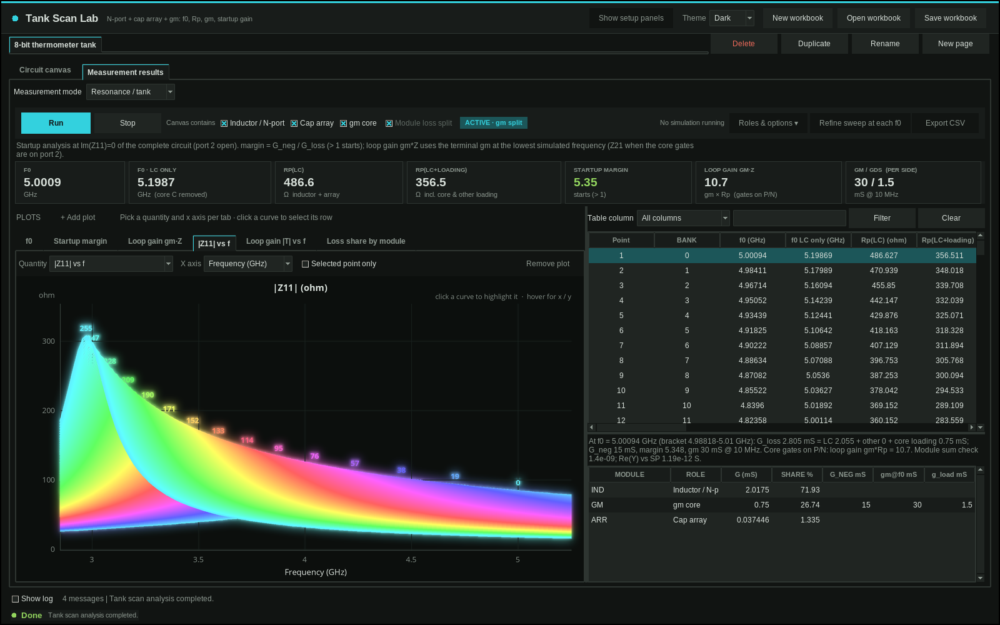 | 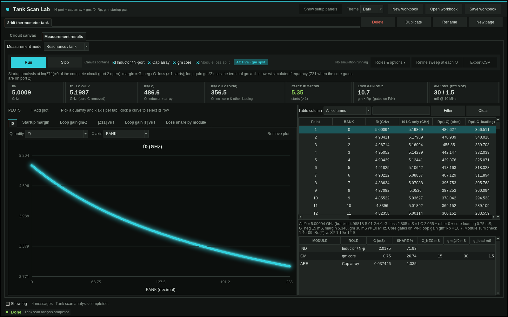 |
| 8 位温度计码阵列放进储能腔：256 个码的 \|Z11\|，每个码一种颜色，标出 f0。 | 绘图页：f0、起振裕量、环路增益等任意量对码作图。 |
| 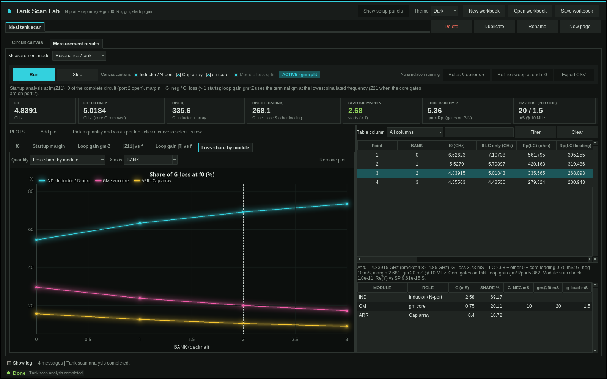 | 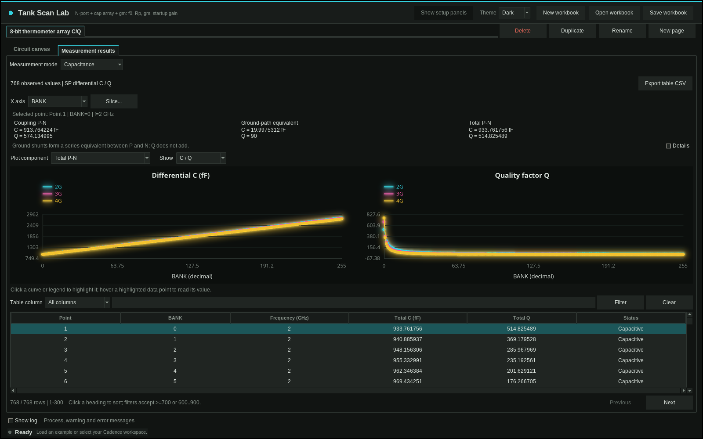 |
| 各模块占 G_loss 的比例随码变化，旁边是结果表和损耗表。 | Capacitance 模式：多个观察频率下逐码的 C 和 Q。 |
| 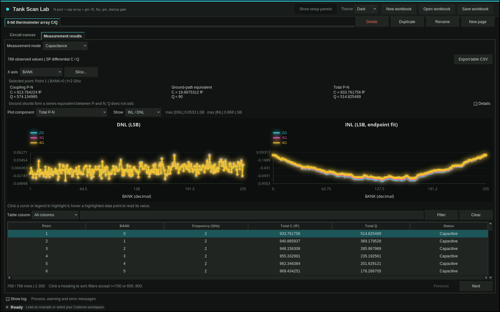 | 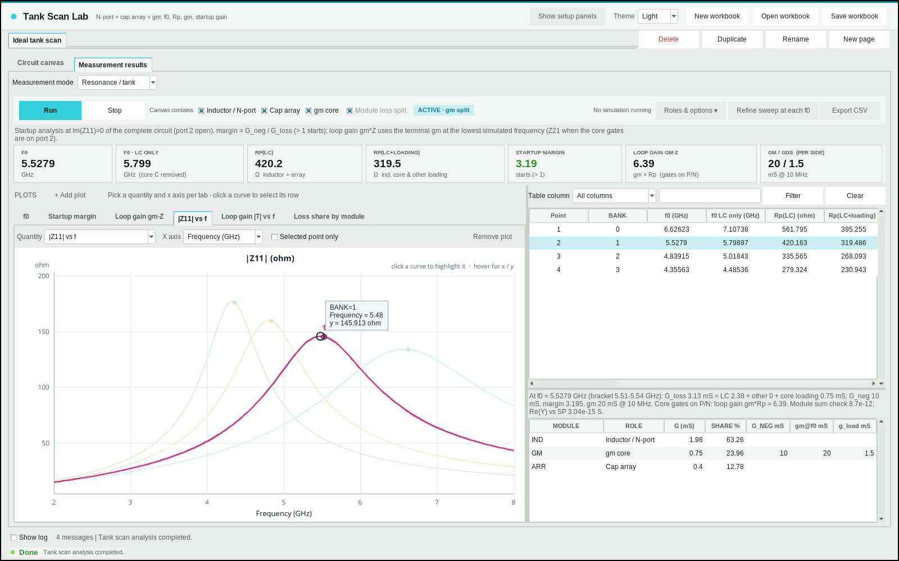 |
| Show → INL / DNL：首尾端点拟合的线性度（LSB），最差值显示在工具栏。 | Light 主题：窗口、画布和图表一起切换。 |

## Z11 Studio

Z11 Studio 是随 Tank Scan Lab 提供的独立 RLC 网络工作台，用在完整仿真之前或旁边：画出 LC 网络，看它的 Z11，扫参、优化元件值，再把结果生成原理图。

| | |
|---|---|
| 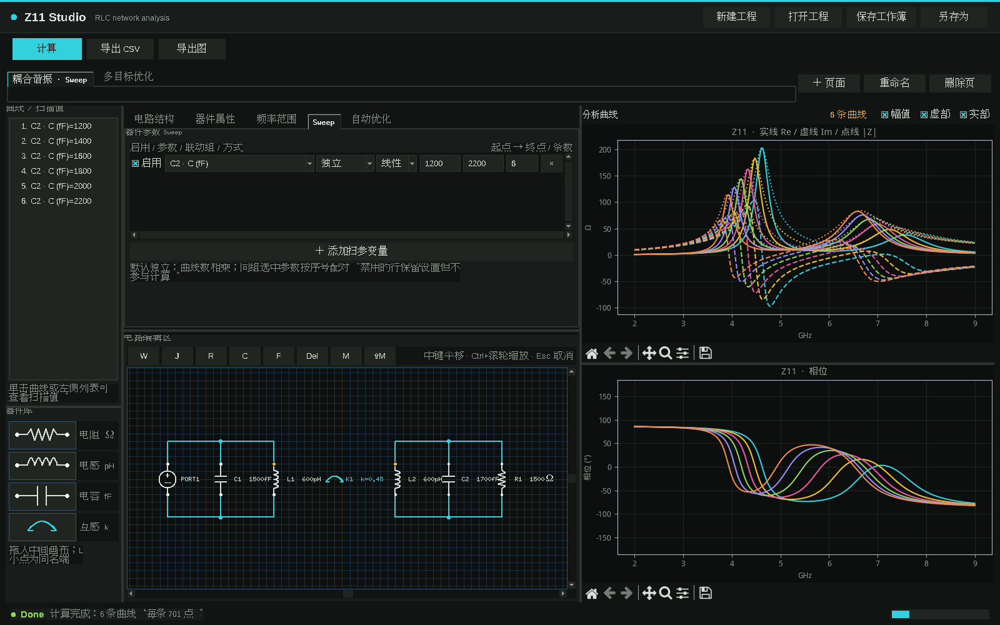 | 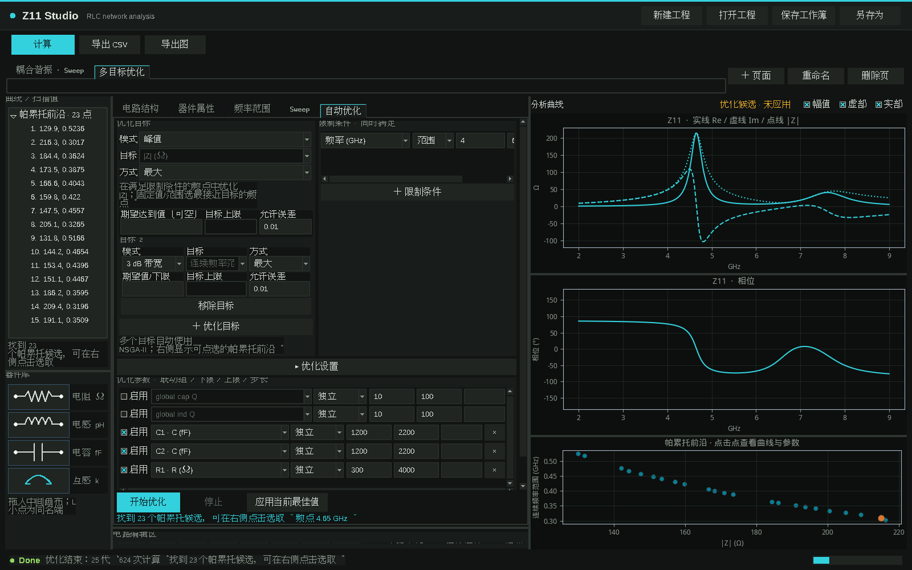 |
| 两个耦合的 LC 谐振腔（k = 0.45，带同名端极性），C2 取 6 个值扫描：每个取值一条 Z11 曲线。 | 两个目标（峰值 \|Z\| 和 3 dB 带宽），峰值限制在 4–6 GHz：NSGA-II 给出 23 个帕累托点，点选可查看对应曲线。 |

- 在多页画布上画 R、L（带 Q）、C 和带同名端极性的互感 k；电路结构可存入库、再加载。
- 内置节点法求解器给出 Z11 的幅值、实部、虚部和相位随频率的变化，不需要仿真器。
- 参数扫描：独立扫描时曲线数相乘；同一联动组里的参数按序号一起变化。
- 优化：目标可以是峰值、3 dB 带宽或自定义量（取最大、最小、达到某值或落在区间内），可加限制条件；单目标用 CMA-ES 或差分进化，多目标用 NSGA-II 并给出帕累托前沿；最佳值可一键写回电路。
- 曲线可导出 CSV 和图片。配置好 Cadence 工作区后，可通过 Maestro 插件为网络生成原理图。
- 从 Tank Scan Lab 的 **Z11 Studio** 按钮打开，或用 `caplab/z11/z11_launch` 单独启动。需要 NumPy 和 Matplotlib（见环境要求），界面为中文。

## 环境要求

主工作台及合成示例需要 Python 3.6+、Tk 8.5+，不需要第三方包。需要图形显示。启动脚本支持 Linux。[Pillow](https://python-pillow.org/) 为可选依赖：安装后图表抗锯齿（Dark 主题带辉光），未安装时用普通 Tk 画布绘制。`CAPLAB_ANTIALIAS=0` 强制普通画布（在基于 RealVNC 的 X 服务器上有用，例如 Cadence 的 cdsXvnc，程序会自动识别），`CAPLAB_ANTIALIAS=1` 强制使用 Pillow。

Z11 Studio 另需 NumPy 1.17+、Matplotlib 3.3+。CMA-ES 优化可选安装 `cma`；差分进化和 NSGA 使用 NumPy。Python 3.6 可使用 NumPy 1.19.5、Matplotlib 3.3.4。主程序 Tk 测试使用 Python 3.6；Z11 GUI 使用本机已有的现代 Python 环境验证，其数值求解器也在 Python 3.6 / NumPy 1.19.5 下通过测试。

原生库浏览、符号导入、SP 测量、模块电流损耗分析和 schematic 创建，需要用户自己的 Cadence Virtuoso/Maestro/Spectre、库映射、器件模型与许可证，仓库不提供。本产品不调用 EMX；提取网络请由用户提供 Touchstone 文件。

## 安装与快速开始

先在仓库根目录打开离线示例：

```bash
python3 app.py --project examples/ideal_array.json
```

Resonance / tank 模式可打开合成示例（解析电感、开关电容和交叉耦合 gm，共四个码）：

```bash
python3 app.py --tank --project examples/ideal_tank.json
```

`bash tank-scan-lab.sh` 直接以 **Resonance / tank** 模式启动，其中的 **Load example** 打开 tank 示例。修改角色或勾选内容只会重新分析已保存的数据；运行新的扫描需要用户自己的原生环境。

大码数示例（合成 8 位温度计码阵列，码 0–255）：

```bash
python3 app.py --tank --project examples/thermo8_cq.json        # C/Q、C 步进、INL/DNL（Capacitance 模式）
python3 -m caplab.thermo_example --tank                          # 生成 examples/thermo8_tank.json（约 45 MB，不入库）
python3 app.py --tank --project examples/thermo8_tank.json      # 256 个码的 f0、Rp、裕量、增益
```

也可以运行 `bash launch.sh` 后点击 **Load example**。选择 **Ideal capacitor array** 查看 C/Q，选择 **Parallel LC resonance**（打开到 **Resonance / tank**：逐码 f0、Rp = Re Z 和 |Z11| 幅相）。示例页中的 **Run SP / Measure C + Q** 执行解析模型回放，状态栏明确标注 synthetic replay；**Stop this page** 可停止。回放使用固定的八码模型和频率网格，编辑画布不会改变模型。开展原生测量时请新建工作簿。

示例不含 PDK 或器件仿真数据。公式、单位、复现方法及合成 Touchstone 说明见 [examples/README.md](examples/README.md)。

使用 Z11 Studio 时，在用户管理的环境中安装可选依赖：

```bash
python3 -m pip install -r requirements-z11.txt
bash caplab/z11/z11_launch
```

主界面的 **Z11 Studio** 按钮打开同一内置程序。无工作区时独立离线运行；已配置原生工作区时，通过绑定来源的 broker 创建 schematic。`Z11_PYTHON` 可指定另一解释器。主工作台为英文界面，Z11 保留原有中文界面。

## 配合 Cadence 使用

用户自行配置环境；仓库不含站点路径或许可证值：

| 配置项 | 含义 |
| --- | --- |
| `CAPLAB_PYTHON` | GUI 解释器；默认使用 PATH 中的 `python3` |
| `CAPLAB_WORKSPACE` | 包含用户 `cds.lib` 的默认工作区；默认为空 |
| `CAPLAB_LIBRARY` | 默认目标库名；默认 `CAP_DEMO` |
| `CAPLAB_NATIVE_VIRTUOSO` | 原生程序；默认使用 PATH 中的 `virtuoso` |
| `CAPLAB_CADENCE_ENV` | 独立启动原生子进程时可选加载的可信 shell 脚本 |
| `CAPLAB_NATIVE_CDS_LIB` | 私有库映射文件的绝对路径，可选 |
| `Z11_PYTHON` | Z11 解释器，可选；否则使用当前 GUI 解释器 |
| `CAPLAB_Z11_PATH` | 外部 Z11 安装覆盖，可选；默认使用内置副本 |

Cadence 与许可证环境由用户提供。GUI 启动会隔离 Python/Tk 库覆盖；从 Maestro 启动则单独保存其原生环境。菜单入口和配置说明见 [docs/CADENCE.md](docs/CADENCE.md)。原生工作流保持不变；tank 分析在开发期间与原生仿真做过交叉验证（数据见 [docs/VALIDATION.md](docs/VALIDATION.md)），仓库检查未运行任何原生工具。

## 面向 agent 的 CLI

```bash
python3 app.py --help
python3 app.py --project examples/ideal_array.json
python3 app.py --tank --project examples/ideal_tank.json
python3 -m caplab.demo
python3 -m caplab.tank_example
python3 -m caplab.thermo_example [--tank] [OUT_DIR]
python3 -m unittest discover -s tests -p 'test_*.py'
```

`caplab.demo` 重新生成两个 C/Q 合成示例文件，`caplab.tank_example` 重新生成 `examples/ideal_tank.json`，`caplab.thermo_example` 重新生成 `examples/thermo8_cq.json`，加 `--tank` 时另外写出 8 位 tank 工作簿。`--context` 为 Maestro 内部启动上下文入口，不是通用网表运行器。无 `DISPLAY` 时 Tk 测试会跳过；完整 UI 测试须使用分配给你的显示。完整测试包含依赖 NumPy 的 Z11 用例。没有无图形的原生仿真 CLI。

## 限制

- Resonance / tank 的数值是 DC 工作点上的小信号结果，即**起振**分析；稳态振荡频率、摆幅、增益压缩和相噪需要大信号（HB / 瞬态）仿真。f0 处的数值在相邻两个采样点之间插值，需要更高精度时使用 **Refine sweep at each f0**。
- 端口 2 的结果假定栅极（或输出）接在 P2/N2 上，一端口量按端口 2 开路计算。gm·Z21 使用低频 gm；栅极极性接反时增益为负。
- C 步进 / INL / DNL 在所选分量的绘图码范围上做端点拟合，由已保存的 C 值计算，不另行仿真。
- 保存频谱按复导纳线性插值，不外推；粗网格可能漏掉窄带或高 Q 谐振。
- 浮地 P/N 分解是端口等效量，不是物理电容清单；各部分 Q 不可相加。
- 模块损耗占比需要完整且通过功率平衡的原生电流数据；C/Q 合成示例明确显示不可用，tank 合成示例包含模块电流。
- 用户工作簿可能包含本地路径、库身份及结果，分享前自行检查。运行状态放在被忽略的 `.work/`、`runs/` 中；Z11 另有自身保存状态。
- 工具不做 DRC/LVS 签核。Touchstone 导入支持指定的全矩阵 ASCII S 参数格式；不支持的关键字、已被修改的源文件会被拒绝。

## 未随仓库提供的内容

以下内容不随本仓库提供：

- 你自己的 Cadence Virtuoso、Maestro、Spectre 安装，以及库映射、器件模型和许可证。
- 电感、变压器的提取 Touchstone 文件（`.sNp`）。本工具不调用 EMX。
- 任何真实工艺的实测数据。示例工作簿（`examples/ideal_tank.json`、`examples/thermo8_cq.json` 等）都是合成的。

需要其中某一项，或想为你的环境要一个示例，请在 [GitHub Issues](https://github.com/chloeyntu-byte/tank-scan-lab/issues) 提出，维护者会在那里回复。

## RF-FIELDWORK

- 总站（全部工具、演示片与项目进展）：https://rf-fieldwork.pages.dev/?lang=zh
- 本工具介绍页（含配音演示片）：https://rf-fieldwork.pages.dev/tank/?lang=zh

其他开源工具：

- [Flux Studio](https://github.com/chloeyntu-byte/flux-studio)：参数化射频无源器件、EMX 扫参、多目标优化与 SNPFit 拟合
- [Layout 3D Viewer](https://github.com/chloeyntu-byte/layout-3d-viewer)：三维阅读版图、定位 pin、追踪连接
- [VCO ISF Explorer](https://github.com/chloeyntu-byte/vco-isf-explorer)：ISF、闪烁噪声上变频与相噪贡献
- [Crescendo](https://github.com/chloeyntu-byte/crescendo)：在 Cadence Maestro 里自动优化器件尺寸
- [VCO Design Studio](https://github.com/chloeyntu-byte/vco-design-studio)：五类文献 LC VCO 拓扑、分层原理图与原生导出

## 许可证

MIT，见 [LICENSE](LICENSE)。
